# Green-Channel CLAHE and a Mild-Weighted Threshold Objective for Cross-Dataset Diabetic Retinopathy Grading with MobileViT-S: An Exploratory Evaluation

**Author:** Zubair Md Ishaq  
**Affiliation:** Independent researcher (no institutional affiliation)  
**Corresponding author:** Zubair Md Ishaq, zubairishaq12@gmail.com  
**Manuscript type:** Original research article  

**Keywords:** diabetic retinopathy; MobileViT; CLAHE; ordinal regression; domain shift; external validation; quadratic weighted kappa; calibration; exploratory evaluation

---

**Transparency note.** During the post-training audit, we identified that seeds 42–44 and 45–47 received different learning-rate schedules because scheduler state was not retained during mid-epoch checkpoint-resume cycles in the first seed set. The two seed sets are therefore reported separately throughout the primary analysis. In addition, the threshold-head implementation did not maintain rank-consistent thresholds; decoded grades are reported, but probability-based calibration is restricted to cross-entropy models. The study is consequently presented as an exploratory, seed-resolved evaluation.

---

## Abstract

**Background.** Deep-learning systems for diabetic retinopathy (DR) grading often degrade when tested on images from new datasets. Green-channel contrast-limited adaptive histogram equalization (CLAHE) and threshold-based ordinal objectives are common design choices, but their behaviour under external distribution shift is uncertain.

**Methods.** We conducted an exploratory evaluation of MobileViT-S trained on APTOS 2019 only. Four configurations crossed RGB or green-channel CLAHE input with cross-entropy or a mild-weighted shared-weight threshold objective. Checkpoints were selected using APTOS validation quadratic weighted kappa (QWK). Models were evaluated on an APTOS internal test split and on IDRiD, Messidor-2 and DeepDRiD. Results are reported separately for seeds 42–44 and 45–47 because the first seed group received a truncated learning-rate schedule after a checkpoint-resume implementation defect, whereas the second received the intended full cosine schedule. We report QWK and grade-1 recall for all configurations; calibration is reported only for cross-entropy models because the threshold-head probabilities were non-monotonic.

**Results.** Results varied by dataset and seed group. In the truncated-schedule group, green-channel CLAHE with cross-entropy (H2) reached APTOS QWK {{sb:H2:APTOS:QWK:a}} and DeepDRiD QWK {{sb:H2:DeepDRiD:QWK:a}}; in the full-cosine group the corresponding values were {{sb:H2:APTOS:QWK:b}} and {{sb:H2:DeepDRiD:QWK:b}}. Under cross-entropy, CLAHE raised QWK relative to RGB (H2 versus H1) on APTOS and DeepDRiD in every seed of both schedule groups, whereas Messidor-2 agreement remained near zero in both groups. Mild recall for H2 was {{sb:H2:APTOS:mild recall:a}} under the truncated schedule and {{sb:H2:APTOS:mild recall:b}} under the full schedule ({{g1n:APTOS}} APTOS grade-1 test images). The mild-weighted threshold objective with CLAHE (H4) was associated with higher external grade-1 recall on several evaluations, but its probability outputs were not rank-consistent. A matched EfficientNet-B0 reference produced higher QWK under the reported training regime.

**Conclusions.** In this constrained, exploratory APTOS-only MobileViT-S study, preprocessing and threshold-loss choices showed dataset-dependent and schedule-sensitive associations with cross-dataset DR grading. The findings do not establish a universally preferred pipeline under this protocol and motivate corrected, version-controlled replications with rank-consistent ordinal heads.

---

## 1. Introduction

Diabetic retinopathy remains a leading cause of preventable blindness. Automated grading of colour fundus photographs on the five-level International Clinical Diabetic Retinopathy (ICDR) scale can support screening when image quality and labelling are well controlled [1–3]. Reviews of the field point to recurring obstacles: class imbalance, heterogeneous cameras, inconsistent preprocessing, limited external validation, and scores that cannot be compared across studies because the protocols differ [4–6].

Mild DR is a particular difficulty. Its defining lesions cover only a few pixels after resizing, and earlier deep-learning methods have been reported to perform poorly at early disease stages [7]. Lightweight CNNs such as EfficientNet are often proposed for low-resource settings [8–10], and hybrid convolution–transformer designs aim to combine local texture with global context [11–13]. Two further choices recur in DR pipelines: CLAHE on the green channel [4,8,14] and ordinal / threshold-based losses that treat grades as ordered [15–17]. Both are usually judged on in-domain test sets, and seldom together under external testing.

**Research question.** In an exploratory APTOS-only MobileViT-S evaluation with checkpoints selected exclusively by APTOS validation QWK, how do RGB and green-channel CLAHE inputs, and cross-entropy versus a mild-weighted shared-weight threshold objective, relate to cross-dataset QWK and mild-stage recall across IDRiD, Messidor-2 and DeepDRiD? For the cross-entropy configurations, how do these preprocessing choices relate to expected calibration error (ECE)?

**Novelty statement.** This study provides an exploratory, seed-resolved evaluation of green-channel CLAHE and a mild-weighted shared-weight threshold objective for cross-dataset diabetic retinopathy grading with MobileViT-S. Rather than introducing a new architecture, it documents how these choices behave across three external datasets under APTOS-only training and APTOS-validation-QWK checkpoint selection. Because a post-training audit identified two learning-rate schedules across seed groups and non-monotonic learned threshold probabilities, results are reported schedule-stratified and calibration is restricted to cross-entropy models. The contribution is therefore transparent, indicative evidence about dataset-dependent trade-offs in QWK and mild-stage recall, together with implementation-level observations needed for a corrected replication.

The contributions are:

1. An exploratory, schedule-stratified MobileViT-S comparison of RGB and green-channel CLAHE inputs with cross-entropy and a mild-weighted threshold objective under APTOS-only training.
2. External evaluation on IDRiD, Messidor-2 and DeepDRiD, reporting QWK, grade-1 recall, prediction distributions and per-seed results.
3. A verification audit showing that the shared-weight threshold head did not maintain rank-consistent thresholds; decoded-grade metrics are retained, whereas probability-based calibration is restricted to cross-entropy models.
4. Secondary, explicitly exploratory reference comparisons involving EfficientNet-B0, Swin-Tiny, input resolution, loss decomposition and leave-one-dataset-out training.
5. A duplicate-image audit and a deduplication sensitivity analysis for the APTOS split.

---

## 2. Related work

**DR grading.** Large deep-learning systems have detected referable DR at operating points comparable to those of clinicians [1], and later systems have covered the full disease spectrum [3]. A retrospective validation study compared an algorithm with clinicians for screening [2]. Surveys describe a field dominated by CNNs and in need of more external testing [4–6].

**Preprocessing.** Green-channel extraction and CLAHE are among the most common preprocessing steps in DR pipelines [4,8,14], and they are often combined with EfficientNet backbones and Grad-CAM inspection [19].

**Ordinal methods.** CORAL, CORN and stick-breaking models represent the grade through cumulative thresholds [15–17]. CORAL’s rank consistency rests on non-increasing threshold biases [15]. An ordinal-sensitive loss has also been combined with a hybrid model for DR grading [12].

**Cross-dataset evaluation.** Generalisation analyses across datasets repeatedly find that in-domain accuracy is a poor guide to performance on new data [21,22]. El Bellaj et al. [20] combined an uncertainty-aware ordinal head with multi-dataset training. Our design differs in that training is restricted to APTOS and preprocessing and loss are varied under a fixed architecture and selection rule.

**Lightweight and hybrid models.** Class imbalance makes mild DR fragile for lightweight CNNs [18]. MobileViT-based hybrids have been used for DR grading [11] and for broader ocular-disease diagnosis [13]. Explanation maps such as Grad-CAM are increasingly expected in clinically oriented pipelines [23].

---

## 3. Materials and methods

### 3.1 Datasets

We used four public collections of colour fundus photographs (Table 1). All labels follow the ICDR scale: grade 0 (no DR), 1 (mild), 2 (moderate), 3 (severe non-proliferative) and 4 (proliferative). Grade distributions are shown in Supplementary Figure S1. APTOS validation data are used for checkpoint selection and temperature fitting; the APTOS test split is an internal held-out test; IDRiD, Messidor-2 and DeepDRiD are external datasets.

**APTOS 2019** [25]. We used a third-party pre-partitioned derivative of the labelled APTOS 2019 release, distributed on Kaggle as the “APTOS-2019 dataset” (version 3), rather than an official competition train/validation/test split ({{n:APTOS:train}}, {{n:APTOS:val}} and {{n:APTOS:test}} images; {{aud:total}} labelled images in total). The archive arrived with separate train, validation and test label files and was used unchanged. Results should therefore be interpreted for this specific partition only. An audit of the partitions is given in Supplementary Table S1. No image identifier appears in more than one partition. Hashing the files and decoded pixel arrays nonetheless found {{aud:pairs}} pairs of identical images, including {{aud:trte}} training–test pairs; {{aud:testdup}} test images have an identical copy in training or validation. These duplicates were left in place so that the partition matches its distributed form; their numerical effect is quantified in Section 4.5. Near-duplicates were not assessed.

**IDRiD** [26]. Official training ({{n:IDRiD:train}}) and test ({{n:IDRiD:test}}) labels were pooled into one external set of {{n:IDRiD:external_all}} images because IDRiD plays no part in training.

**Messidor-2** [27–29]. Fundus images were taken from the Messidor-2 collection [27,28]. Adjudicated five-level DR severity and gradability labels were those distributed with the Google Brain Messidor-2 DR grades release associated with the Krause et al. adjudication protocol [29]; images not marked gradable were excluded, leaving {{n:Messidor-2:external_gradable}} images.

**DeepDRiD** [30]. Regular fundus images from the training and validation parts gave {{n:DeepDRiD:external_eval}} graded images.

{{table:datasets}}

### 3.2 Study design and training

Figure 1 summarises the study and the protocol deviation that structures all reporting. Models are trained on APTOS only, the checkpoint is chosen by APTOS validation QWK, and the chosen model is then tested once on the APTOS test split and on each external dataset. EfficientNet-B0, Swin-Tiny and leave-one-dataset-out training are secondary exploratory branches.

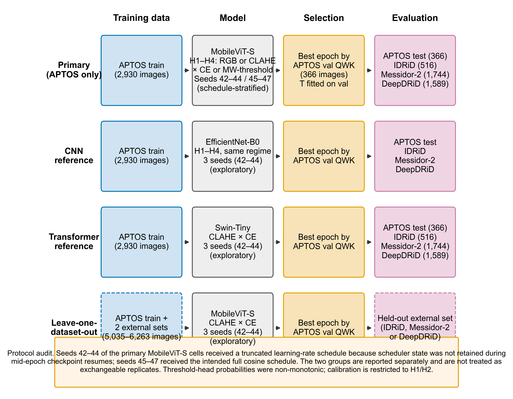

**Figure 1.** Overview of the study with protocol-deviation disclosure. The primary path trains MobileViT-S on APTOS only, selects the checkpoint by APTOS validation QWK and fits the calibration temperature on the same {{n:APTOS:val}} validation images. Seeds 42–44 and 45–47 are shown as separate schedule groups because the first group received a truncated learning-rate schedule. EfficientNet-B0, Swin-Tiny and leave-one-dataset-out training are labelled exploratory secondary branches.

Table 2 lists the training settings. All models used ImageNet-pretrained weights, 224×224 input, AdamW [31] with learning rate 1 × 10⁻⁴ and weight decay 1 × 10⁻⁴, a cosine schedule stepped once per epoch, and 20 epochs. The MobileViT-S configurations were executed with six seed-labelled runs, separated into two non-equivalent seed groups. Seeds 42–44 received a truncated learning-rate schedule because scheduler state was not restored during repeated mid-epoch checkpoint resumes ({{steps:trunc}} steps per launch; {{env:resumes}} resumes per primary run). Seeds 45–47 received the intended full cosine schedule. We therefore treat the two groups as separate exploratory replication sets, not as six exchangeable replicates of one protocol. Across the 24 primary runs, the selected epoch ranged from {{bestep:min}} to {{bestep:max}} (Supplementary Figure S2). The full regime audit is in Supplementary Table S2.

All models were trained on a CPU with batch size 4. Batch-normalisation layers were kept in evaluation mode [24]. MobileViT-S contains both batch-normalisation and layer-normalisation layers; Swin-Tiny has only layer normalisation. Training ran on an {{env:cpu}} ({{env:cores}} cores, {{env:ram}} GB RAM, {{env:os}}) with Python {{env:python}}, PyTorch {{env:torch}}, torchvision {{env:torchvision}} and timm {{env:timm}} [32]. Evaluation used the Apple GPU (MPS). Inference cost is summarised in Supplementary Figure S3.

{{table:settings}}

### 3.3 Preprocessing

We compared two input pipelines (Figure 2):

1. **RGB.** Convert to RGB, resize to 224×224 and normalise with ImageNet statistics.
2. **Green-channel CLAHE.** Extract the green channel at native resolution, enhance with CLAHE [33] (OpenCV, clip limit 2.0, 8×8 tiles), copy into three channels, resize to 224×224 and normalise.

Because CLAHE uses a fixed 8×8 tile grid before resizing, tile scale is not equivalent across datasets with different native resolutions. No field-of-view crop was applied. Augmentation details are in Supplementary Figure S4.

**Figure 2.** Preprocessing of an APTOS image with mild DR (grade 1). (a) Original RGB; (b) green channel; (c) green channel after CLAHE at native resolution; (d) RGB after resize to 224×224; (e) CLAHE input after resize; (f, g) boxed detail.

### 3.4 Models

The primary model is MobileViT-S [34] from timm [32], with global average pooling followed by either a five-output cross-entropy head or a four-output threshold head (Supplementary Figure S5). EfficientNet-B0 [35] and Swin-Tiny [36] serve as exploratory CNN and transformer references. Example images from each dataset are shown in Supplementary Figure S6.

### 3.5 Threshold-head objective, decoded grades, and implementation audit

**Cross-entropy.** Softmax over five grades; the most probable grade is the prediction.

**Threshold head and mild-weighted objective.** The threshold head used a shared feature-weight vector and four threshold-specific biases, resembling the shared-weight construction used in CORAL [15]. However, the threshold biases were unconstrained and initialised in increasing order ({{coral:init}}). Each threshold is trained with target t_k = 1{y > k}. The mild-weighted (MW) objective multiplies the binary terms by fixed threshold weights (2, 2, 1, 1) and by a sample weight of 2 for grade-1 images. Decoding counts thresholds with σ(z) > 0.5. Class probabilities are formed by differencing cumulative sigmoids, then clipping negatives and renormalising. Figure 3 summarises the cross-entropy head, the mild-weighted threshold head and the rank-consistency failure observed after training.

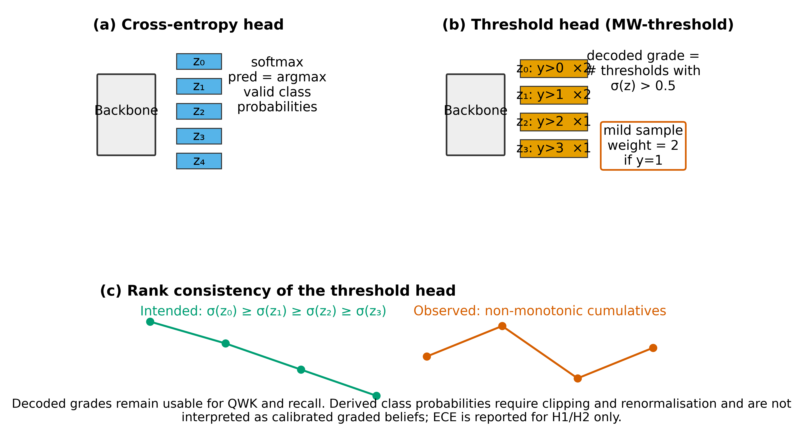

**Figure 3.** Output heads used in this study. (a) Cross-entropy head with valid softmax class probabilities. (b) Mild-weighted threshold head with shared weight and four biases. (c) Rank-consistency schematic: the intended ordered cumulatives versus the non-monotonic cumulatives observed after training. Decoded grades remain usable for QWK and recall; derived class probabilities are not interpreted as calibrated graded beliefs.

**Verification.** Code checks confirmed the shared weight, targets, mild weighting and decoding (Supplementary Table S3). After training, the biases were non-increasing in {{coral:nordered}} of {{coral:nruns}} threshold-head runs, and σ(z₀) ≥ σ(z₁) ≥ σ(z₂) ≥ σ(z₃) was violated for at least {{coral:minnonmono}} of test images in every run and test set. We therefore do not describe the trained models as rank-consistent CORAL models. Decoded grades are reported; ECE is not reported for threshold-head configurations.

### 3.6 The 2×2 design

| Cell | Input | Loss |
|---|---|---|
| H1 | RGB | Cross-entropy |
| H2 | Green-channel CLAHE | Cross-entropy |
| H3 | RGB | MW threshold objective |
| H4 | Green-channel CLAHE | MW threshold objective |

### 3.7 Metrics, calibration and statistics

The primary descriptive metrics are QWK and grade-1 recall. We also report accuracy, macro-F1, mild precision/F1, confusion matrices and referable-DR (grade ≥ 2) sensitivity, specificity and ROC AUC (positive class grade ≥ 2; CE score = sum of softmax p₂…p₄; threshold-head score = σ(z₁)).

Calibration analyses were restricted to the cross-entropy configurations H1 and H2 because their softmax outputs form valid class-probability distributions. Calibration metrics are not reported for threshold-head configurations because the learned cumulative outputs were non-monotonic. ECE used 15 equal-width bins; a single temperature T was fitted on APTOS validation logits in [0.05, 20] [38].

Comparisons are descriptive because seed-labelled runs were separated into two non-equivalent schedule groups. Within each schedule group, paired seed-level differences are reported as effect sizes and sign patterns. We do not use pooled six-seed hypothesis tests as confirmatory evidence. Image-level bootstrap intervals for seeds 42–44 are shown in Supplementary Figure S7; they do not model within-subject dependence where paired-eye images are present.

### 3.8 Secondary exploratory analyses

Leave-one-dataset-out training, matched EfficientNet-B0, Swin-Tiny, loss decomposition (D1/D2) and 448×448 sensitivity checks are secondary exploratory analyses. They are reported in the supplement and should not be read as confirmatory backbone or resolution tests. Grad-CAM [37] was used only for qualitative inspection after evaluation.

---

## 4. Results

### 4.1 Protocol audit and reporting structure

Before interpreting performance, we report a protocol audit that affects the organization of all results. The MobileViT-S runs labelled with seeds 42–44 received a truncated learning-rate schedule because scheduler state was not retained during mid-epoch checkpoint resumes (logged final learning rate {{sched:lrfinal:trunc}}). Runs labelled 45–47 received the intended full cosine schedule (final learning rate 0). The training script was edited between these groups, although the recoverable logs confirmed the schedule difference only. We therefore report the two groups separately and interpret all comparisons as exploratory. In addition, the threshold-head outputs were non-monotonic, so probability-based calibration is presented only for the cross-entropy configurations. Complete per-seed values are in Supplementary Tables S4 and S5.

### 4.2 Schedule-stratified cross-dataset QWK

Table 3 and Figure 4 show QWK separately for each schedule group. Agreement was high on APTOS in both groups and fell sharply on every external dataset (Supplementary Figure S8). On Messidor-2, mean QWK remained near zero for every cell and both schedule groups. The direction of the CLAHE contrast was not stable across all datasets and schedule groups. In the truncated-schedule group, H2 APTOS QWK was {{sb:H2:APTOS:QWK:a}} versus {{sb:H1:APTOS:QWK:a}} for H1; in the full-cosine group the corresponding values were {{sb:H2:APTOS:QWK:b}} and {{sb:H1:APTOS:QWK:b}}. In the truncated-schedule group, H2 did not exceed H1 on IDRiD ({{sb:H2:IDRiD:QWK:a}} versus {{sb:H1:IDRiD:QWK:a}}). In the full-cosine group, H2 exceeded H1 ({{sb:H2:IDRiD:QWK:b}} versus {{sb:H1:IDRiD:QWK:b}}). The most repeated pattern was on APTOS and DeepDRiD, where H2 exceeded H1 in every seed of both schedule groups (Section 4.7; DeepDRiD differences {{pgrp:qwk:H2-H1:DeepDRiD:a:d}} and {{pgrp:qwk:H2-H1:DeepDRiD:b:d}}).

Under the full cosine schedule, RGB input with cross-entropy (H1) collapsed on the external datasets: QWK was {{sb:H1:IDRiD:QWK:b}} on IDRiD, {{sb:H1:Messidor-2:QWK:b}} on Messidor-2 and {{sb:H1:DeepDRiD:QWK:b}} on DeepDRiD, external grade-1 recall was zero in every seed (Section 4.3), and the share of Messidor-2 images predicted as grade 0 was {{mp0:H1:45-47}} (Section 4.7). Matched EfficientNet-B0 with the same RGB input and loss reached {{b0m:H1:IDRiD}}, {{b0m:H1:Messidor-2}} and {{b0m:H1:DeepDRiD}} on these datasets under the same CPU, batch-size and frozen-batch-normalisation regime (Section 4.7), so this collapse is attributed at least partly to the MobileViT-S configuration under the reported training regime rather than to RGB input alone.

{{table:qwk}}

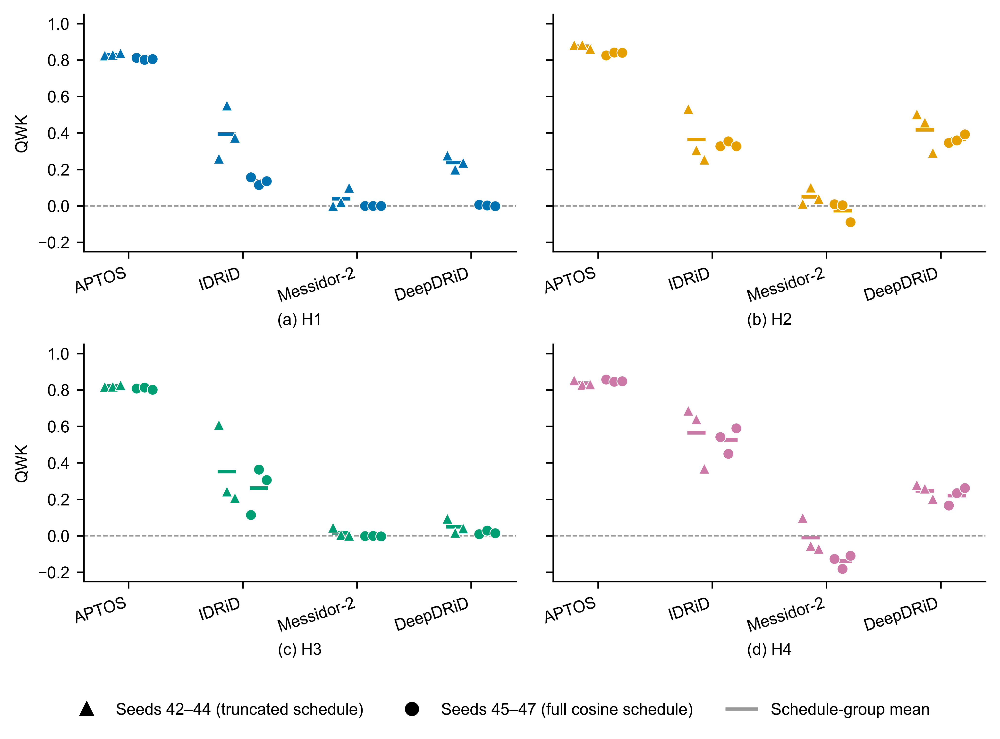

**Figure 4.** Schedule-stratified QWK for the four MobileViT-S configurations across the APTOS internal test split and three external datasets. Triangles denote seeds 42–44, which received a truncated learning-rate schedule; circles denote seeds 45–47, which received the intended full cosine schedule. Horizontal bars summarise each schedule group separately. The two groups are not treated as exchangeable replicates.

### 4.3 Schedule-stratified mild-stage recall

Table 4 and Figure 5 summarise grade-1 recall. Because APTOS contains only {{g1n:APTOS}} grade-1 test images and IDRiD contains {{g1n:IDRiD}}, estimates are highly variable. For H2, APTOS mild recall was {{sb:H2:APTOS:mild recall:a}} under the truncated schedule (exactly {{mildk:H2:a}} of {{g1n:APTOS}} images in each seed) and {{sb:H2:APTOS:mild recall:b}} under the full schedule. Table 5 extends grade-1 recall to the external datasets. The H3 IDRiD value in the truncated group ({{g1grp:H3:IDRiD:a}}) is driven by one degenerate run: seed 42 recalled {{g1run:H3:42:IDRiD}} grade-1 images only because it assigned grade 1 to {{predshare:H3:42:idrid_external:1}} IDRiD images, whereas seeds 43 and 44 recalled {{g1run:H3:43:IDRiD}} and {{g1run:H3:44:IDRiD}}. This estimate, and the H3 grade-1 contrasts derived from it (Section 4.7), should not be read as evidence of mild-stage detection. The mild-weighted threshold objective was associated with higher grade-1 recall in several specific group/dataset combinations—for example H4 on Messidor-2 and IDRiD—but this descriptive pattern does not establish an isolated ordinal-loss effect because the threshold head was not rank-consistent and the experiment was schedule-stratified. Additional APTOS metrics are in Supplementary Figure S9.

{{table:mild}}

{{table:g1}}

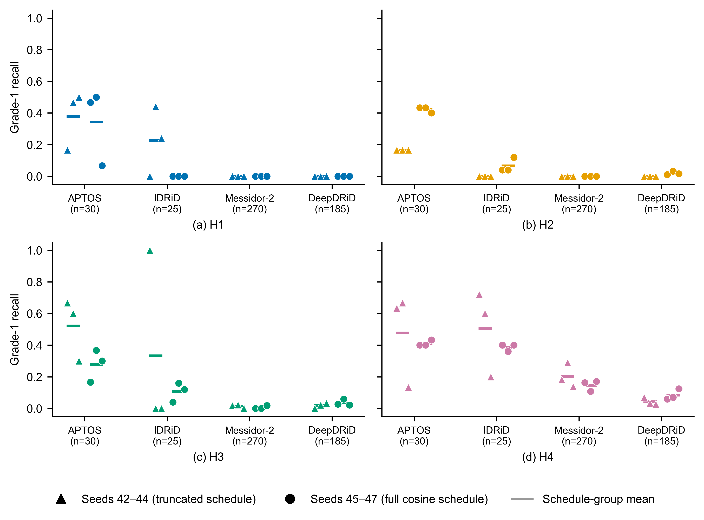

**Figure 5.** Grade-1 recall across datasets for each MobileViT-S configuration. Because APTOS contains only 30 grade-1 test images and IDRiD contains 25, estimates are highly variable. Results are shown separately for the two schedule groups (triangles: seeds 42–44, truncated schedule; circles: seeds 45–47, full cosine schedule).

### 4.4 Calibration of cross-entropy configurations only

Table 6 and Figure 6 report ECE for H1 and H2 only. On APTOS, schedule-group ECE values are reported in Table 6. ECE rose on every external dataset. Temperature scaling, fitted on APTOS validation data, changed external ECE only modestly for these cross-entropy models (Supplementary Figure S10). Threshold-head configurations are excluded because their learned cumulative outputs were non-monotonic and their derived class probabilities were not interpretable. Confusion matrices summed over seeds are shown in Supplementary Figures S11–S14.

{{table:ece}}

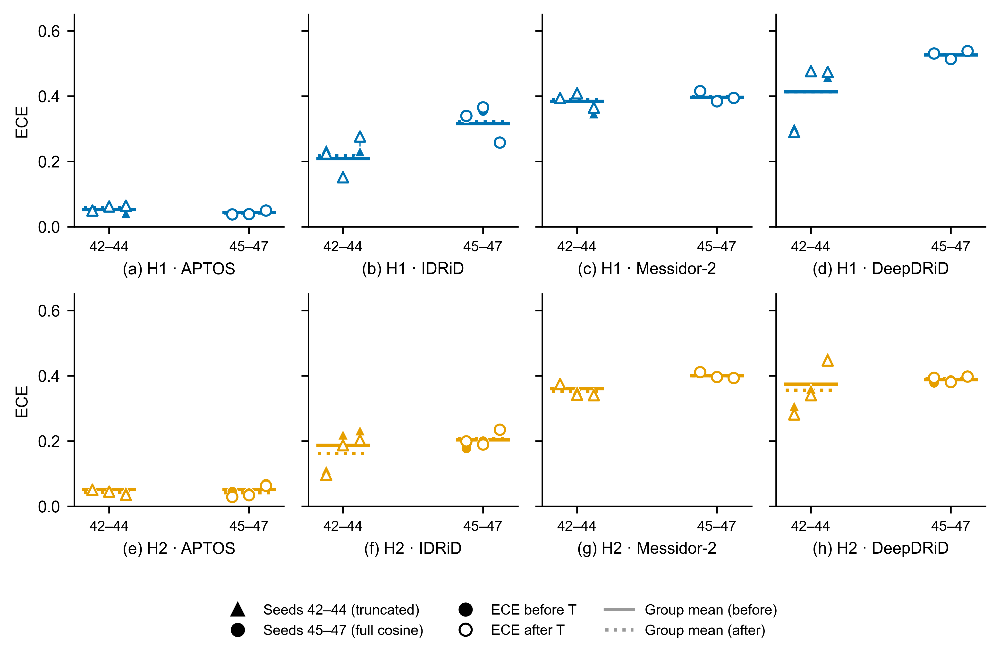

**Figure 6.** Calibration of the cross-entropy configurations H1 and H2. Filled markers show ECE before temperature scaling and open markers show ECE after scaling; triangles denote seeds 42–44 (truncated schedule) and circles denote seeds 45–47 (full cosine schedule). Threshold-head configurations are excluded because their learned cumulative outputs were non-monotonic and their derived class probabilities were not interpretable.

### 4.5 Deduplication sensitivity

The distributed APTOS partition contains {{aud:pairs}} exact duplicate pairs; {{aud:testdup}} test images have an exact copy in training or validation, and {{aud:difflabel}} cross-partition pairs carry different grades (Supplementary Table S1). Removing the {{aud:testdup}} affected test images ({{dedup:nkept}} remaining) changed schedule-group mean QWK by at most {{dedup:grpmax}} for any configuration, and the QWK of any single run by at most {{dedup:runmax}} (Supplementary Table S6). For H2, QWK was {{dedup:sb:H2:a:all}} with all images versus {{dedup:sb:H2:a:dedup}} after deduplication in the truncated-schedule group, and {{dedup:sb:H2:b:all}} versus {{dedup:sb:H2:b:dedup}} in the full-cosine group. Supplementary Table S6 also reports mild recall, macro-F1, accuracy and referable-DR metrics for all configurations, and ECE, negative log-likelihood (NLL) and Brier score for H1 and H2, on both subsets. Exact-duplicate leakage therefore exists in the distributed partition, and the sensitivity analysis quantifies its numerical impact rather than claiming that leakage is absent.

### 4.6 Messidor-2 prediction collapse

The observed near-zero Messidor-2 QWK was associated with a strong collapse toward grade-0 predictions. H2 predicted grade 0 for a mean share of {{mp0:H2:42-44}} of the {{mess:n}} gradable images in the truncated-schedule group (seed 42: {{mess:pred0:H2:42}}) and {{mp0:H2:45-47}} in the full-cosine group. H4 spread predictions more widely ({{mp0:H4:42-44}} and {{mp0:H4:45-47}}, respectively) without restoring ordinal agreement. Confusion matrices are shown in Supplementary Figure S13; prediction-share plots are shown in Supplementary Figure S15.

### 4.7 Secondary exploratory analyses

The following analyses are secondary and exploratory. Referable-DR operating points for seeds 42–44 are summarised in Supplementary Figure S16.

Matched EfficientNet-B0 produced higher QWK than MobileViT-S under the reported training regime when compared with schedule-matched MobileViT-S seeds 45–47 (Table 7; Supplementary Figure S17).

{{table:b0}}

Descriptive within-group paired differences between the primary cells are summarised in Table 8.

{{table:paired}}

Swin-Tiny with CLAHE × cross-entropy also exceeded MobileViT-S H2 on all four test sets within the truncated-schedule seed set (Table 9).

{{table:arch}}

Leave-one-dataset-out training raised held-out QWK relative to APTOS-only H2 but confounds extra data with domain diversity (Table 10; Supplementary Figure S18).

{{table:lodo}}

Qualitative Grad-CAM maps of mild APTOS test images are in Supplementary Figure S19.

Loss decomposition under CLAHE (Table 11; Supplementary Figure S20) indicated that mild sample weighting under cross-entropy (D2) raised APTOS mild recall relative to truncated-schedule H2 ({{decomp:D2:APTOS:mild}} versus {{sb:H2:APTOS:mild recall:a}}), but only modestly relative to full-cosine H2 ({{sb:H2:APTOS:mild recall:b}}), so a general mild-weighting gain is not established. The unweighted threshold formulation (D1) was associated with much of the IDRiD gain, and incremental synergy between mild weighting and the threshold objective was not established.

{{table:decomp}}

At 448×448 (Table 12; Supplementary Figure S21), H2 IDRiD QWK was {{res448:H2:448:IDRiD}}, versus {{sb:H2:IDRiD:QWK:a}} and {{sb:H2:IDRiD:QWK:b}} at 224×224 in the two schedule groups. APTOS mild recall was {{res448:H2:448:mild recall}}, versus {{sb:H2:APTOS:mild recall:b}} for the schedule-matched full-cosine 224×224 group; this difference is small relative to seed variability, so a resolution effect on mild recall is not established. Messidor-2 QWK remained near zero despite a large reduction in grade-0 predictions ({{mess448:H2:448}} versus {{mp0:H2:42-44}} and {{mp0:H2:45-47}}).

{{table:res448}}

---

## 5. Discussion

This exploratory study does not identify a universally preferred preprocessing or loss configuration for cross-dataset DR grading. Across two non-equivalent schedule groups, green-channel CLAHE and the mild-weighted threshold objective showed dataset-dependent associations with QWK and grade-1 recall. The results should not be interpreted as causal estimates of preprocessing or ordinal-loss effects because the seed groups received different learning-rate schedules and the threshold head did not preserve rank-consistent cumulative probabilities.

The shared-weight threshold head produced decoded grades that could be evaluated with QWK and classwise recall, but its learned cumulative outputs were non-monotonic. We therefore do not interpret the model as rank-consistent CORAL, and we do not compare its calibration with that of cross-entropy. A corrected replication should enforce ordered thresholds throughout optimization and should reassess whether mild-stage gains persist when valid probability outputs are available.

Effects were strongly dataset-dependent: moderate agreement on IDRiD or DeepDRiD coexisted with near-collapse on Messidor-2. Mild-stage estimates rest on only {{g1n:APTOS}} APTOS grade-1 test images and are schedule-sensitive. Matched EfficientNet-B0 was stronger under the reported CPU / batch-4 / frozen-BN regime, but that comparison is secondary and schedule-aware. The most repeated pattern was that CLAHE raised APTOS and DeepDRiD QWK under cross-entropy in every seed of both schedule groups, alongside the consistent failure on Messidor-2. RGB with cross-entropy collapsed externally under the full cosine schedule, whereas matched EfficientNet-B0 did not, which points at least partly to the MobileViT-S configuration under this training regime. Higher resolution was associated with higher H2 IDRiD QWK, but its APTOS mild-recall difference from the schedule-matched full-cosine 224×224 runs was small, and it did not restore Messidor-2 QWK.

The primary MobileViT-S experiments were trained on a CPU with batch size 4 and frozen batch-normalisation layers because of available hardware. A normal-batch-normalisation, larger-batch GPU sensitivity analysis was not available within the study period. Accordingly, the reported results should be interpreted within this fixed training regime.

---

## 6. Limitations

1. Schedule stratification: seeds 42–44 and 45–47 are not exchangeable replicates.
2. Threshold-head non-monotonicity: calibration of H3/H4/D1 is not interpretable.
3. Small mild subset ({{g1n:APTOS}} APTOS grade-1 test images).
4. Third-party APTOS partition with exact cross-split duplicates; near-duplicates not assessed.
5. No field-of-view crop; CLAHE tile scale differs across native resolutions.
6. Secondary analyses use three seeds and may retain schedule mismatches.
7. Image-level bootstrap intervals ignore paired eyes.
8. Scope is one hybrid architecture under one hardware-constrained regime.

---

## 7. Conclusion

In an exploratory APTOS-only MobileViT-S evaluation, green-channel CLAHE and a mild-weighted threshold objective produced dataset-dependent, schedule-sensitive differences in external QWK and mild-stage recall. Neither configuration consistently raised performance across IDRiD, Messidor-2 and DeepDRiD. The cross-entropy configurations showed substantial external calibration degradation on some datasets, whereas calibration of the threshold-head configurations could not be interpreted because their learned cumulative outputs were non-monotonic. These findings emphasize the need for corrected, version-controlled replications, deduplicated partitions, rank-consistent ordinal heads and multi-dataset evaluation before making deployment-oriented claims.

---

## Declarations

**Funding.** This research received no external funding.

**Competing interests.** The author declares no competing interests.

**Author contributions (CRediT).** Zubair Md Ishaq: conceptualisation, methodology, software, validation, formal analysis, investigation, data curation, visualisation, writing (original draft), and writing (review and editing).

**Ethics approval.** Not applicable. The study used only publicly available, de-identified datasets released for research.

**Use of AI-assisted tools.** AI-assisted tools were used to support code development and the drafting and editing of the manuscript. The author designed the study, reviewed all code, results and text, and takes full responsibility for the content.

**Acknowledgements.** The author thanks the providers of the APTOS 2019, IDRiD, Messidor-2 and DeepDRiD datasets for making them available for research.

**Data availability.** The APTOS 2019 partition used here is the third-party Kaggle “APTOS-2019 dataset” (version 3) [25], a train/validation/test split of the APTOS 2019 Blindness Detection images. IDRiD [26], Messidor-2 images [27,28] with the adjudicated grades associated with [29], and DeepDRiD [30] are publicly available from their providers under their respective licences. No images are redistributed with this study; checksums of the label files used are provided with the code release.

**Code availability.** The training and evaluation code, the configuration file of every run, the seed list, the metric files, the environment record and the scripts that generate every table and figure are public at https://github.com/Zubair121Md/DR_RP (release v1.0.0-exploratory) and will be archived on Zenodo with a DOI before publication. Per-image predictions and logits are available from the author on reasonable request (zubairishaq12@gmail.com).

---

## References

[1] Gulshan V, Peng L, Coram M, et al. Development and validation of a deep learning algorithm for detection of diabetic retinopathy in retinal fundus photographs. *JAMA*. 2016;316(22):2402–2410. https://doi.org/10.1001/jama.2016.17216

[2] Shah P, Mishra DK, Shanmugam MP, Doshi B, Jayaraj H, Ramanjulu R. Validation of deep convolutional neural network-based algorithm for detection of diabetic retinopathy – artificial intelligence versus clinician for screening. *Indian Journal of Ophthalmology*. 2020;68(2):398–405. https://doi.org/10.4103/ijo.IJO_966_19

[3] Dai L, Wu L, Li H, et al. A deep learning system for detecting diabetic retinopathy across the disease spectrum. *Nature Communications*. 2021;12:3242. https://doi.org/10.1038/s41467-021-23458-5

[4] Alyoubi WL, Shalash WM, Abulkhair MF. Diabetic retinopathy detection through deep learning techniques: a review. *Informatics in Medicine Unlocked*. 2020;20:100377. https://doi.org/10.1016/j.imu.2020.100377

[5] Bappi MI, Juthy JA, Kim K. Deep learning-based diabetic retinopathy recognition and grading: challenges, gaps, and an improved approach — a survey. *ICT Express*. 2025;11(5):993–1013. https://doi.org/10.1016/j.icte.2025.08.001

[6] Chopra M, Sparrenberg L, Berger A, Khanna S, Terheyden JH, Sifa R. From retinal pixels to patients: evolution of deep learning research in diabetic retinopathy screening. *arXiv preprint* arXiv:2511.11065. 2025. https://arxiv.org/abs/2511.11065

[7] Qummar S, Khan FG, Shah S, Khan A, Shamshirband S, Rehman ZU, Khan IA, Jadoon W. A deep learning ensemble approach for diabetic retinopathy detection. *IEEE Access*. 2019;7:150530–150539. https://doi.org/10.1109/ACCESS.2019.2947484

[8] Raiaan MAK, Fatema K, Khan IU, et al. A lightweight robust deep learning model gained high accuracy in classifying a wide range of diabetic retinopathy images. *IEEE Access*. 2023;11:42361–42388. https://doi.org/10.1109/ACCESS.2023.3272228

[9] Arora L, Singh SK, Kumar S, et al. Ensemble deep learning and EfficientNet for accurate diagnosis of diabetic retinopathy. *Scientific Reports*. 2024;14:30554. https://doi.org/10.1038/s41598-024-81132-4

[10] Astuti Y, Nurhaisah S. EfficientNet-B0 convolutional network for early detection and severity classification of diabetic retinopathy. *Applied Computer Science and Software Engineering*. 2026;2(1). https://doi.org/10.63254/acsse.v2i1.32

[11] Wan Z, Wan J, Cheng W, et al. A wireless sensor system for diabetic retinopathy grading using MobileViT-Plus and ResNet-based hybrid deep learning framework. *Applied Sciences*. 2023;13(11):6569. https://doi.org/10.3390/app13116569

[12] Memon MS, Qabulio M, Basir N, Soomro AK, Naqvi SHF. Hybrid convolutional transformer learning utilizing ordinal sensitive loss for automated grading of diabetic retinopathy. *VFAST Transactions on Software Engineering*. 2026;14(1):124–136. https://doi.org/10.21015/vtse.v14i1.2344

[13] Wang H, Ke T, Lv H. A CNN-ViT hybrid architecture Res101-MViT-Ens for accurate and lightweight automated ocular disease diagnosis. *Applied Sciences*. 2026;16(6):2905. https://doi.org/10.3390/app16062905

[14] Jabbar A, Liaqat HB, Akram A, et al. A lesion-based diabetic retinopathy detection through hybrid deep learning model. *IEEE Access*. 2024;12:40019–40036. https://doi.org/10.1109/ACCESS.2024.3373467

[15] Cao W, Mirjalili V, Raschka S. Rank consistent ordinal regression for neural networks with application to age estimation. *Pattern Recognition Letters*. 2020;140:325–331. https://doi.org/10.1016/j.patrec.2020.11.008

[16] Shi X, Cao W, Raschka S. Deep neural networks for rank-consistent ordinal regression based on conditional probabilities. *Pattern Analysis and Applications*. 2023;26(3):941–955. https://doi.org/10.1007/s10044-023-01181-9

[17] Liu X, Zou Y, Song Y, Yang C, You J, Kumar BVKV. Ordinal regression with neuron stick-breaking for medical diagnosis. In: *Computer Vision – ECCV 2018 Workshops*. Lecture Notes in Computer Science. Springer; 2019:335–344. https://doi.org/10.1007/978-3-030-11024-6_23

[18] Das PK, Pumrin S. Diabetic retinopathy classification: performance evaluation of pre-trained lightweight CNN using imbalance dataset. *Engineering Journal*. 2024;28(7):13. https://doi.org/10.4186/ej.2024.28.7.13

[19] Ghadai KK, Nayak SK, Senapati BR. A clinically interpretable deep learning pipeline for diabetic retinopathy classification using EfficientNet, advanced data augmentation and GradCAM. *BMC Ophthalmology*. 2026;26:406. https://doi.org/10.1186/s12886-026-04897-4

[20] El Bellaj A, Benradi A, El Youssoufi S, El Marzouki T, Cheddadi MA. Uncertainty-aware ordinal deep learning for cross-dataset diabetic retinopathy grading. *arXiv preprint* arXiv:2602.10315. 2026. https://arxiv.org/abs/2602.10315

[21] Kazmi M, Imran B, Qazi SA, Siddiqui MAR. A generalizability analysis framework for bias resilience in convolution neural network and transformer models for diabetic retinopathy screening. *PLOS One*. 2026;21(8):e0351225. https://doi.org/10.1371/journal.pone.0351225

[22] Ali U, Imam AA, Apong RA. MoCo-DRG: patch and image-level self-supervision for generalizable diabetic retinopathy grading. In: *Proceedings of the 17th ACM International Conference on Bioinformatics, Computational Biology and Health Informatics (ACM-BCB)*. 2026:1–6. https://doi.org/10.1145/3807503.3819353

[23] Civit-Masot J, Luna-Perejon F, Muñoz-Saavedra L, et al. An explainable ensemble for diabetic retinopathy grading with a novel confidence quality factor and configurable heatmaps. *Medical & Biological Engineering & Computing*. 2026;64(4):1231–1247. https://doi.org/10.1007/s11517-026-03514-2

[24] Wu Y, Johnson J. Rethinking “batch” in BatchNorm. *arXiv preprint* arXiv:2105.07576. 2021. https://arxiv.org/abs/2105.07576

[25] MariaHerreroT. APTOS-2019 dataset: the APTOS 2019 Blindness Detection images classified into training, validation and testing groups (version 3). Kaggle dataset. https://www.kaggle.com/datasets/mariaherrerot/aptos2019. Accessed 16 September 2026. Third-party partition of: Asia Pacific Tele-Ophthalmology Society. APTOS 2019 Blindness Detection. Kaggle competition. 2019. https://www.kaggle.com/c/aptos2019-blindness-detection

[26] Porwal P, Pachade S, Kamble R, et al. Indian Diabetic Retinopathy Image Dataset (IDRiD): a database for diabetic retinopathy screening research. *Data*. 2018;3(3):25. https://doi.org/10.3390/data3030025

[27] Decencière E, Zhang X, Cazuguel G, et al. Feedback on a publicly distributed image database: the Messidor database. *Image Analysis & Stereology*. 2014;33(3):231–234. https://doi.org/10.5566/ias.1155

[28] Abràmoff MD, Folk JC, Han DP, et al. Automated analysis of retinal images for detection of referable diabetic retinopathy. *JAMA Ophthalmology*. 2013;131(3):351–357. https://doi.org/10.1001/jamaophthalmol.2013.1743

[29] Krause J, Gulshan V, Rahimy E, et al. Grader variability and the importance of reference standards for evaluating machine learning models for diabetic retinopathy. *Ophthalmology*. 2018;125(8):1264–1272. https://doi.org/10.1016/j.ophtha.2018.01.034

[30] Liu R, Wang X, Wu Q, et al. DeepDRiD: diabetic retinopathy—grading and image quality estimation challenge. *Patterns*. 2022;3(6):100512. https://doi.org/10.1016/j.patter.2022.100512

[31] Loshchilov I, Hutter F. Decoupled weight decay regularization. In: *International Conference on Learning Representations (ICLR)*. 2019. https://arxiv.org/abs/1711.05101

[32] Wightman R. PyTorch Image Models (timm), version {{env:timm}}. Software. 2019. https://doi.org/10.5281/zenodo.4414861

[33] Zuiderveld K. Contrast limited adaptive histogram equalization. In: Heckbert PS, ed. *Graphics Gems IV*. Academic Press; 1994:474–485.

[34] Mehta S, Rastegari M. MobileViT: light-weight, general-purpose, and mobile-friendly vision transformer. In: *International Conference on Learning Representations (ICLR)*. 2022. https://arxiv.org/abs/2110.02178

[35] Tan M, Le QV. EfficientNet: rethinking model scaling for convolutional neural networks. In: *Proceedings of the 36th International Conference on Machine Learning*. PMLR 97; 2019:6105–6114. https://proceedings.mlr.press/v97/tan19a.html

[36] Liu Z, Lin Y, Cao Y, et al. Swin Transformer: hierarchical vision transformer using shifted windows. In: *Proceedings of the IEEE/CVF International Conference on Computer Vision (ICCV)*. 2021:9992–10002. https://doi.org/10.1109/ICCV48922.2021.00986

[37] Selvaraju RR, Cogswell M, Das A, Vedantam R, Parikh D, Batra D. Grad-CAM: visual explanations from deep networks via gradient-based localization. In: *Proceedings of the IEEE International Conference on Computer Vision (ICCV)*. 2017:618–626. https://doi.org/10.1109/ICCV.2017.74

[38] Guo C, Pleiss G, Sun Y, Weinberger KQ. On calibration of modern neural networks. In: *Proceedings of the 34th International Conference on Machine Learning*. PMLR 70; 2017:1321–1330. https://proceedings.mlr.press/v70/guo17a.html

---

## Supplementary material

{{table:s_split}}

{{table:s_regime}}

{{table:s_coral}}

{{table:s_master}}

{{table:s_batch}}

{{table:s_dedup}}

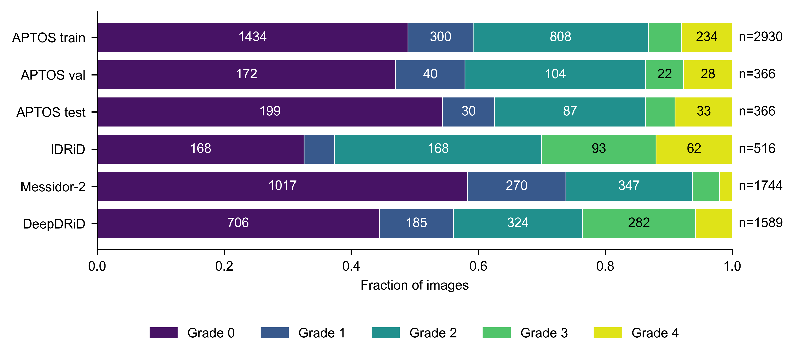

**Figure S1.** Distribution of ICDR grades in each split. Bars show the fraction of images per grade, the numbers inside the bars give image counts, and the total for each split is shown on the right.

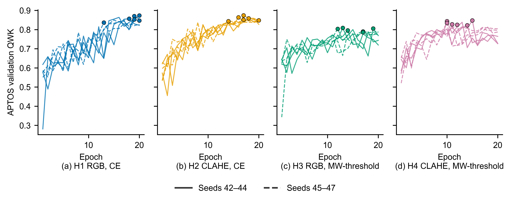

**Figure S2.** APTOS validation QWK per epoch for each primary cell. Solid lines are seeds 42–44 (truncated schedule) and dashed lines seeds 45–47 (full cosine schedule); markers show the selected epoch. (a) H1; (b) H2; (c) H3; (d) H4.

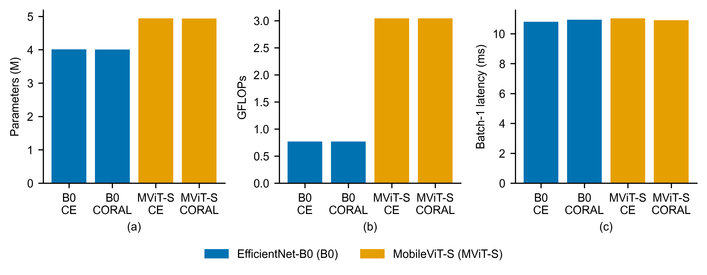

**Figure S3.** Inference cost of EfficientNet-B0 and MobileViT-S with each head, measured on the Apple M2 integrated GPU (MPS backend) with batch size 1. (a) Parameters; (b) GFLOPs at 224×224; (c) mean latency over repeated runs.

**Figure S4.** Training augmentation applied to the cached 224×224 image of the APTOS example from Figure 2. (a) Cached input; (b–e) four random draws of flip, rotation and brightness/contrast jitter, for the RGB pipeline (top) and the CLAHE pipeline (bottom).

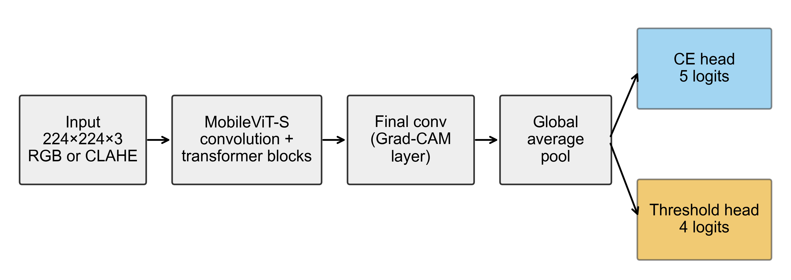

**Figure S5.** MobileViT-S as used in this study. The backbone is followed by global average pooling and either a five-logit cross-entropy head or a four-logit threshold head.

**Figure S6.** Example images from APTOS, IDRiD, Messidor-2 and DeepDRiD. For each dataset, one grade 0 image and one grade 2 image were drawn with a fixed random seed. The native image size is given below each image.

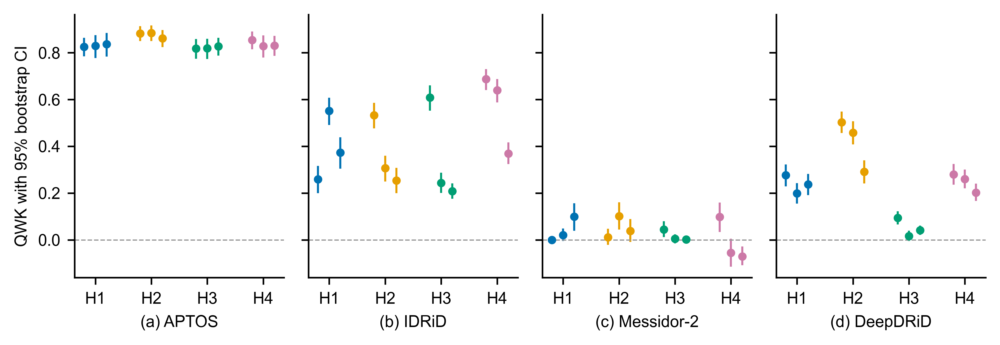

**Figure S7.** QWK of each primary run with seeds 42–44 and a 95% image-level bootstrap confidence interval ({{boot:n}} resamples). The intervals are conditional on image-level sampling and do not model paired eyes. (a) APTOS; (b) IDRiD; (c) Messidor-2; (d) DeepDRiD.

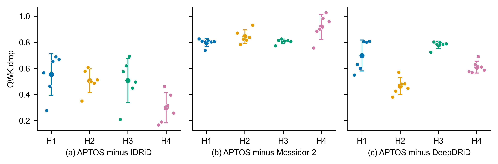

**Figure S8.** Fall in QWK from the APTOS test split to each external dataset, computed per seed and shown for both schedule groups. (a) IDRiD; (b) Messidor-2; (c) DeepDRiD.

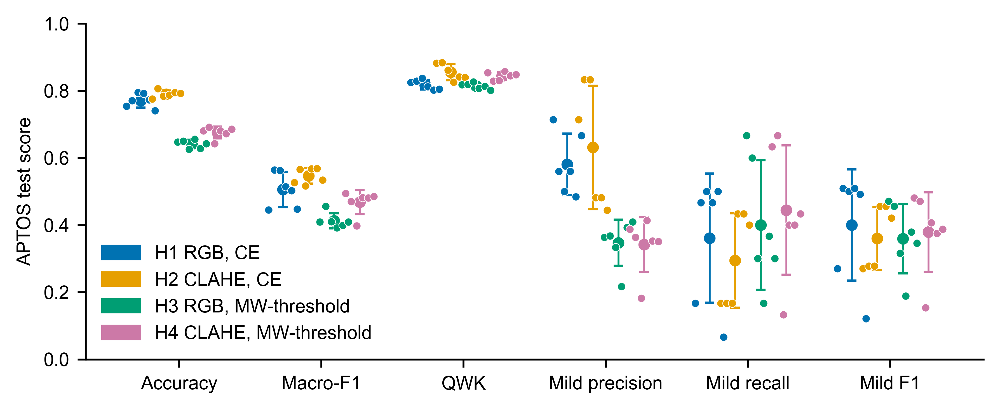

**Figure S9.** Accuracy, macro-F1, QWK and mild-stage precision, recall and F1 on the APTOS test split. Seeds 42–44 (truncated schedule) and 45–47 (full cosine schedule) are plotted as separate series; the six seeds are not pooled. Small points are seeds; large points and bars show the mean ± standard deviation within each schedule group.

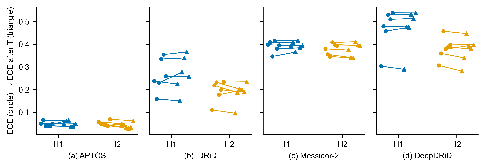

**Figure S10.** ECE of the cross-entropy cells H1 and H2 before and after temperature scaling, one pair per run, with schedule groups distinguished. The temperature was fitted on APTOS validation data. (a) APTOS; (b) IDRiD; (c) Messidor-2; (d) DeepDRiD.

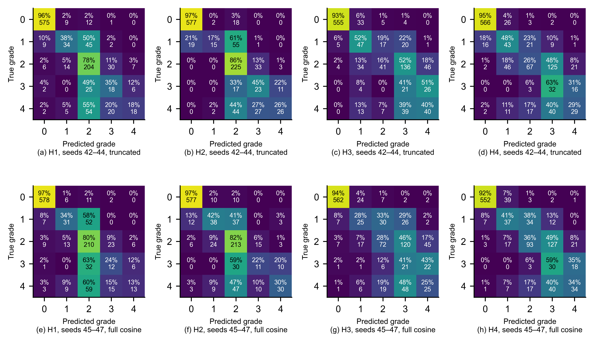

**Figure S11.** Confusion matrices on the APTOS test split, shown separately for each schedule group and summed over the three seeds within the group. Top row (a–d): H1–H4, seeds 42–44 (truncated schedule); bottom row (e–h): H1–H4, seeds 45–47 (full cosine schedule).

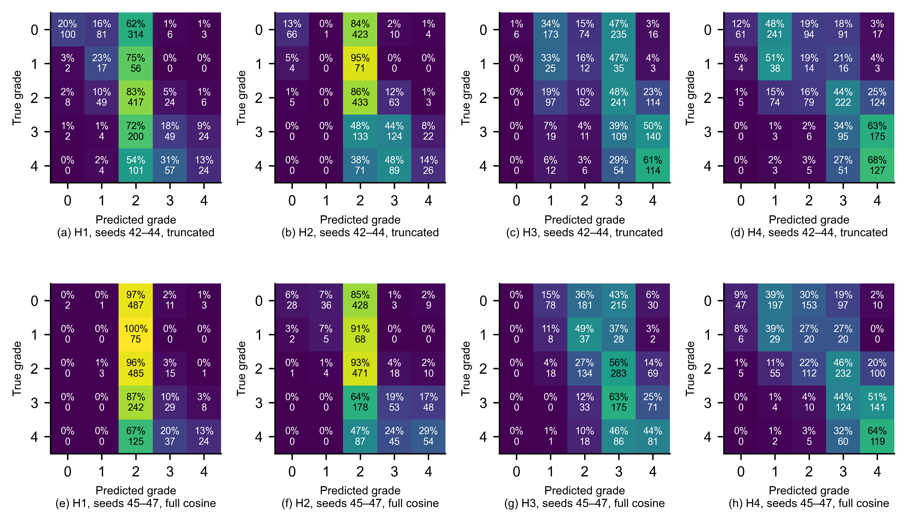

**Figure S12.** Confusion matrices on IDRiD, shown separately for each schedule group and summed over the three seeds within the group. Top row (a–d): H1–H4, seeds 42–44 (truncated schedule); bottom row (e–h): H1–H4, seeds 45–47 (full cosine schedule).

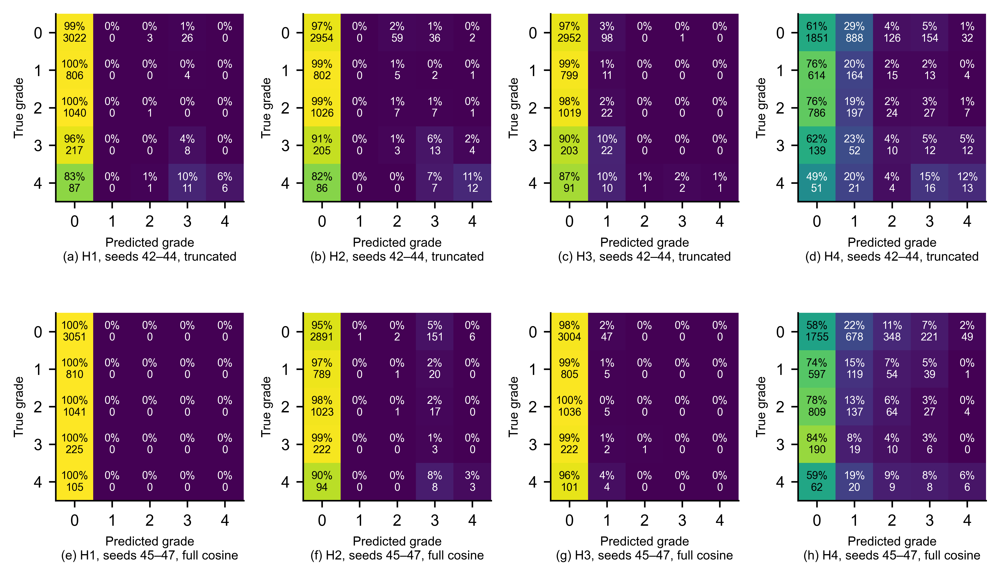

**Figure S13.** Confusion matrices on Messidor-2, shown separately for each schedule group and summed over the three seeds within the group. Top row (a–d): H1–H4, seeds 42–44 (truncated schedule); bottom row (e–h): H1–H4, seeds 45–47 (full cosine schedule).

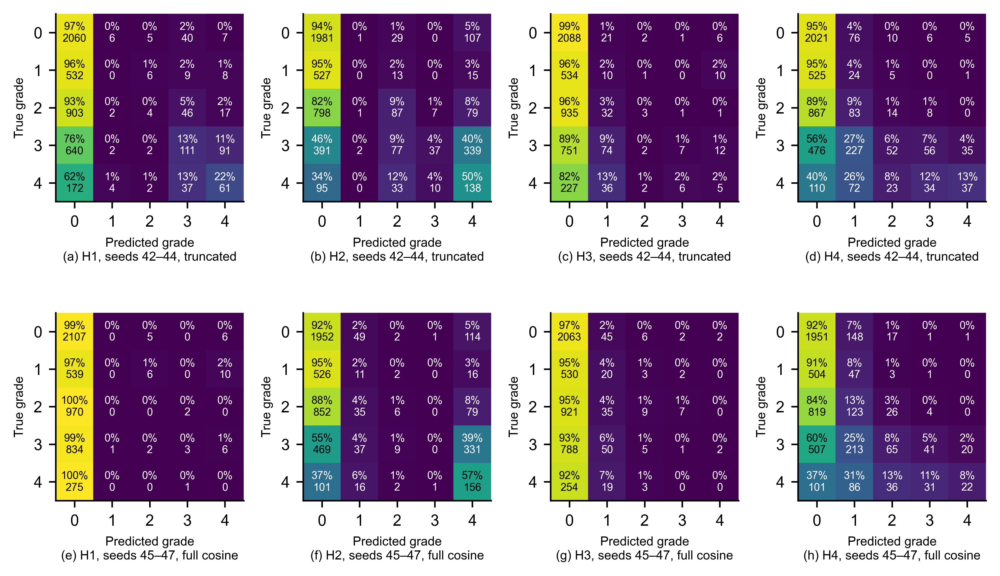

**Figure S14.** Confusion matrices on DeepDRiD, shown separately for each schedule group and summed over the three seeds within the group. Top row (a–d): H1–H4, seeds 42–44 (truncated schedule); bottom row (e–h): H1–H4, seeds 45–47 (full cosine schedule).

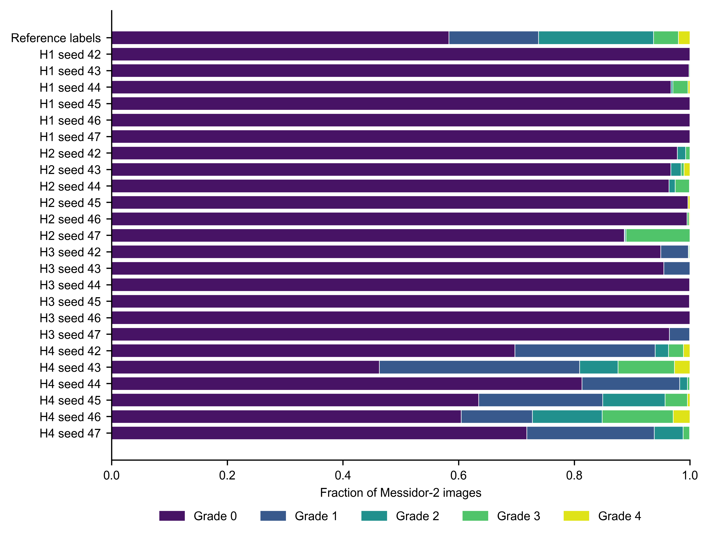

**Figure S15.** Share of each predicted grade on Messidor-2. Each bar is one primary MobileViT-S run (cells H1–H4), ordered within each cell as seeds 42–44 (truncated schedule) then 45–47 (full cosine schedule); the two schedule groups are not pooled into a single bar. Bar segments give the fraction of the {{mess:n}} gradable images assigned to grades 0–4. The top bar shows the reference grade distribution.

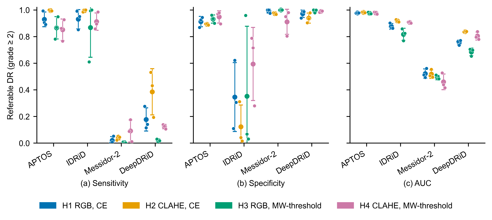

**Figure S16.** Detection of referable DR (grade 2 or above) on each test set, seeds 42–44. The score is the summed softmax probability of grades 2–4 for cross-entropy models and σ(z₁) for threshold-head models; AUC is the binary ROC AUC per run (Section 3.7). (a) Sensitivity; (b) specificity; (c) AUC.

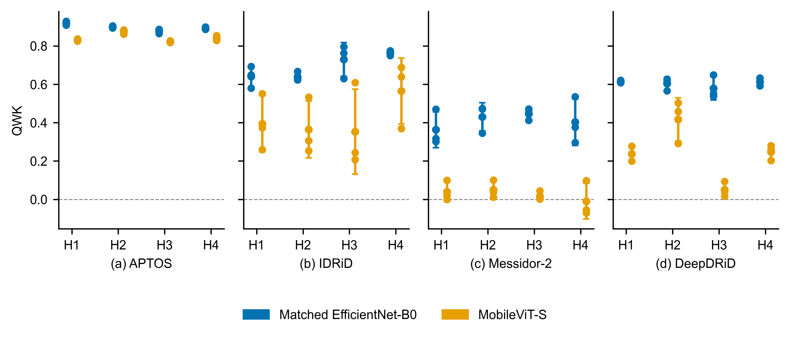

**Figure S17.** Matched EfficientNet-B0 reference comparison against MobileViT-S under the reported training regime (seeds 42–44 for both backbones in this plot). This is a secondary exploratory analysis.

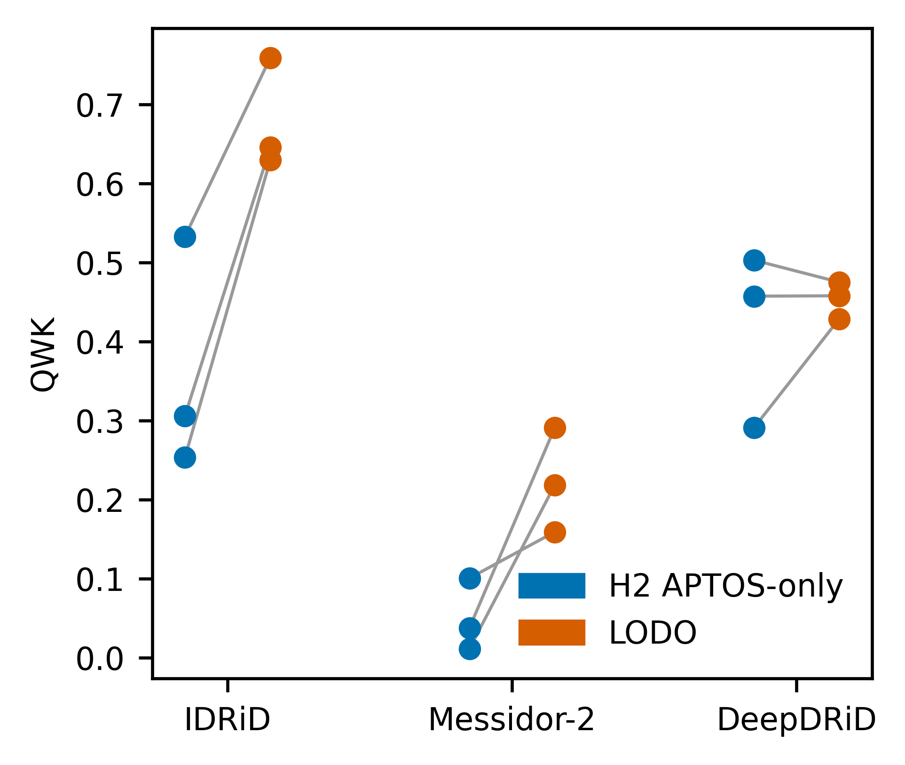

**Figure S18.** Leave-one-dataset-out training as an exploratory data-enrichment analysis. QWK on each held-out dataset for LODO training and for APTOS-only H2 (seeds 42–44).

**Figure S19.** Qualitative Grad-CAM inspection of mild APTOS test images (seed 42), selected after evaluation. Images 1–3 were graded correctly by H2 and images 4–6 were misclassified by H2.

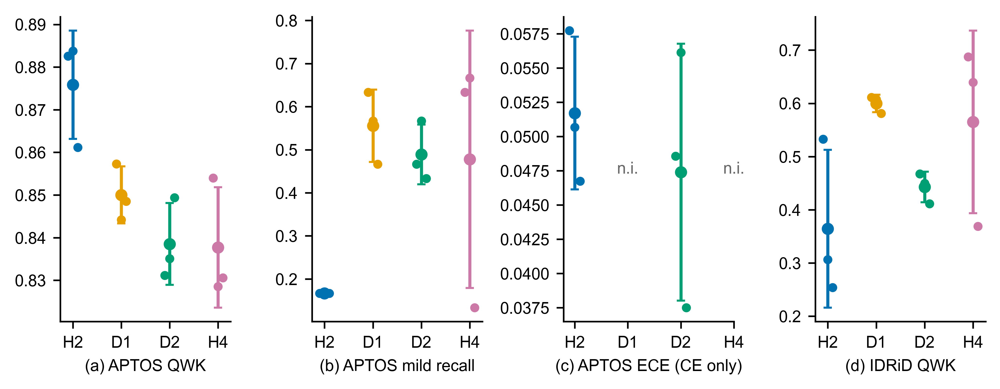

**Figure S20.** Exploratory decomposition of the MW threshold objective under green-channel CLAHE (seeds 42–44): H2, D1 (unweighted threshold), D2 (MW-CE) and H4. ECE is shown for cross-entropy cells only.

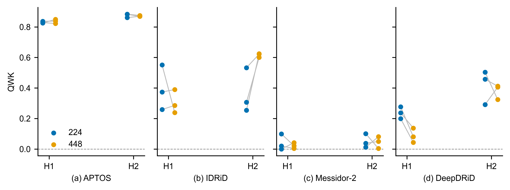

**Figure S21.** Sensitivity of H1 and H2 to input resolution (224×224 versus 448×448; seeds 42–44). This secondary analysis is also affected by schedule differences relative to the full-cosine 224×224 seeds 45–47 (Table 12).
